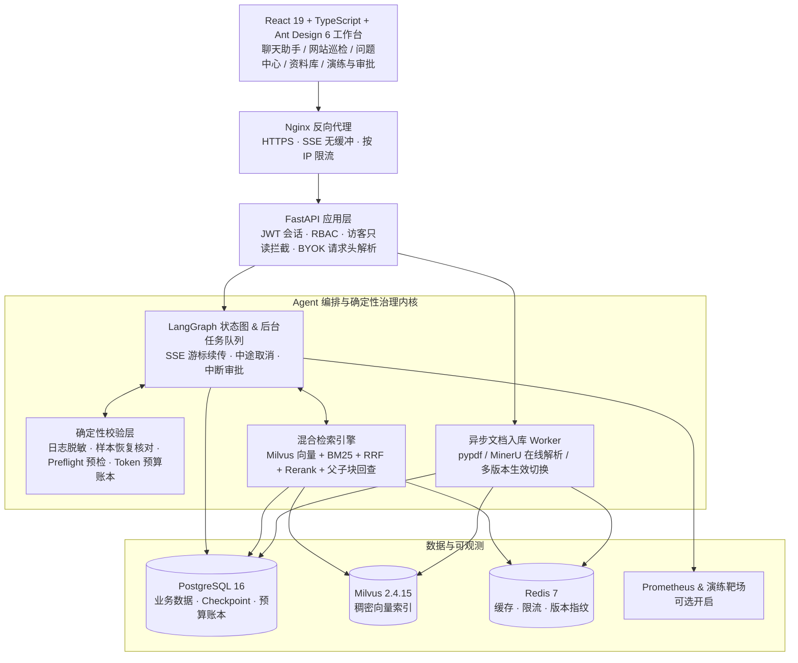

# OpsPilot

**面向开发者与小团队的证据驱动运维工作台与智能维护助手**

OpsPilot 将日常运维问答、知识库检索、网站巡检、日志脱敏诊断、操作结果核对与人工审批整合在同一个工作台中。核心设计原则是：**大模型负责推理、检索编排与建议生成；确定性程序负责权限边界、日志脱敏、恢复核对、预算门控与审批状态机。**

> **在线体验**：[https://47.107.106.89/](https://47.107.106.89/)
> - **免注册体验**：点击登录页「访客直接进入」，可浏览内置的多站点巡检趋势、历史对话、排障记录、审批工单、评测记录与故障演练回放，并可直接向助手提问。
> - **注册个人空间**：支持公开注册独立账号，拥有隔离的网站档案、私人手册库与排障记录。
> - **切换自带模型**：登录后可在右上角「模型设置」接入自己的 OpenAI 兼容模型，整套 Agent 工作流（聊天、手册检索、诊断、复测）统一生效，API Key 仅在内存临时使用，不落库、不记录日志。

文档导航：[架构设计](docs/ARCHITECTURE.md) · [接口说明](docs/API.md) · [评测说明](docs/EVAL.md)

---

## 核心闭环


- **证据优先**：诊断报告严格区分日志事实（精确到证据编号与行号）、待验证假设、缺失信息与可执行的只读检查步骤，所有引用可一键回查原文页码或日志片段。
- **恢复以数据为准**：不会因模型口头判断或单次点击就标记恢复；程序核对自动解析带时区日志、Nginx 访问日志、原接口匹配度、HTTP 状态码/耗时/请求样本、连接池异常行与容器状态，将越权恢复结论强制收口到实测结果。
- **人机边界清晰**：个人网站维护采用低侵入只读观测与脱敏日志分析，实际变更由运维人员执行；涉及工单创建或演练复位等写操作统一走变更前预检（Preflight）与人工审批闸门。

---

## 核心功能

### 1. 智能维护助手（统一入口）
- **自然对话与手册检索**：普通问答中涉及个人系统或手册时，自动从用户已生效的私有手册召回片段并附带可点击「参考片段」溯源。
- **对话流内证据化诊断**：直接粘贴报错日志或点击「诊断」，服务端自动脱敏后在对话流内生成结构化诊断卡片，支持确认检查方案、逐步提交复测结果与查看问题详情。
- **流式交互与后台运行**：SSE 实时推送阶段进度、工具调用与正文增量；支持中途停止生成与断线按事件游标续传。
- **全链路自带模型（BYOK）**：在「模型设置」中可随时切换至自有 OpenAI 兼容网关，与平台模型共用同一套 Agent 工作流（检索、脱敏、复测核对与审批继续由 OpsPilot 管理），且不消耗平台 Token 额度。

### 2. 维护资料库与混合检索（RAG）
- **内置官方来源排障库**：覆盖 **16 个主流技术组件、20 篇结构化排障指南**（Docker、Kubernetes、Nginx、PostgreSQL、MySQL、Redis、Kafka、Elasticsearch、Java / JVM、Python、SQLAlchemy、FastAPI / Gunicorn、Node.js、Go、Linux、systemd），附真实官方文档链接、适用版本、只读排查命令与回退注意点；另含高频异常场景向导。
- **私有手册多版本管理**：支持上传 PDF / Markdown / TXT，持久化异步入库（`uploaded → parsing → chunking → indexing → ready`），支持进度查看、失败重试、文件去重、多版本切换与原文下载。
- **多形态 PDF 解析**：内置 `pypdf` 文本提取、支持配置 **MinerU 在线 API** 自动精准解析复杂版面 PDF，也支持附带离线 `content_list.json` 导入。
- **混合检索链路**：Milvus 稠密向量 + BM25（`jieba` 分词）+ RRF 融合 + 宽召回可选 DashScope Rerank + 父子块上下文回查；检索缓存按文档版本指纹自动失效；支持按网站隔离检索，未绑定网站时默认覆盖本人全部已生效私有手册。

### 3. 网站中心与问题管理
- **网站档案与依赖视图**：记录环境、业务分组、负责人、技术栈、组件上下游依赖关系与手动发布/配置变更时间线（自动与日志时间窗对照）。
- **只读观测与告警接入**：
  - 主动单次 HTTP 检查与定时巡检（SSRF 防护、固定已校验公网 IP、保留 SNI、禁止跳转），自动绘制 SVG 响应耗时与健康趋势图，连续异常自动建档；
  - 外部告警 Webhook 接入（兼容 Alertmanager、Uptime Kuma 与通用 JSON），自动脱敏并聚合同站点问题。
- **问题全生命周期**：状态流转、严重度与标签管理、维护时间线、同工作区交接复核、Markdown 排障报告导出与批量归档/移除。

### 4. 安全治理与受控故障演练
- **多租户认证与权限**：JWT 服务端可撤销登录会话（退出/改密即吊销）、`admin / engineer / viewer` 角色隔离、公开注册自动分配独立私人租户、只读访客中间件拦截写操作、Nginx 按 IP 限流。
- **全链路成本与安全防护**：
  - Fail-closed Token 预算账本（支持 PostgreSQL / JSONL，按保守字节上界预留并按实际用量结算，防止死循环或异常调用打穿账单）；
  - 日志脱敏自动遮蔽密码、Token、数据库连接串、API Key 与邮箱，并提示人工核对公网 IP；
  - BYOK 模型网关严格 SSRF 校验（生产环境强制 HTTPS 并拦截私网、回环、云元数据与重定向），凭据仅驻留单次运行内存。
- **可选故障演练靶场（`DRILL_ENABLED`）**：面向内置演练服务的原生 Function Calling 多工具调查（Prometheus 指标、请求日志、历史故障与知识库）、只读 MCP 工具封装、可选检索子 Agent、LangGraph `interrupt/resume` 人工审批建单与受控复位动作（执行前后自动探针验证，支持四眼原则 `STRICT_FOUR_EYES`）。

---

## 系统架构



### 技术栈

| 层级 | 主要组件 |
| --- | --- |
| **前端** | React 19 · TypeScript · Ant Design 6 · React Router 7 · Vite 8 · Playwright E2E |
| **后端** | Python 3.11+ · FastAPI · SQLAlchemy 2（同步短事务会话）· Alembic · Structlog |
| **Agent 与 RAG** | LangGraph（PostgreSQL / SQLite Checkpoint）· OpenAI 兼容模型接口 · MCP · `pymilvus` · `rank-bm25` + `jieba` · DashScope Rerank · MinerU API |
| **数据与基础设施** | PostgreSQL 16 · Milvus 2.4.15（单容器 `embedEtcd`）· Redis 7 · Prometheus · Nginx · Docker Compose |

### 目录结构

```text
.
├── app/
│   ├── agent/          # LangGraph 状态图、原生工具循环、检索子图、Skill 声明与 LLM 适配
│   ├── api/            # FastAPI 路由（助手、诊断、网站、问题、知识库、演练、工单、评测）
│   ├── auth/           # JWT 服务端会话认证、RBAC 依赖、登录与访客路由
│   ├── db/             # SQLAlchemy 模型、连接池预算、Alembic 迁移配置
│   ├── knowledge/      # 内置 20 篇官方来源排障库与异常场景指南
│   ├── rag/            # 分块、文档解析（pypdf/MinerU）、Milvus/BM25 混合检索、重排与证据组装
│   └── services/       # 后台运行队列、BYOK 临时模型与 SSRF 校验、预算账本、巡检与脱敏核对
├── frontend/           # React + TypeScript 工作台源码与 Playwright E2E 测试
├── deploy/nginx/       # 生产 HTTP / HTTPS 与 SSE 反向代理配置
├── scripts/            # 初始化管理员、数据灌入、数据库迁移、在线验收脚本
├── eval/               # 离线检索基准与评测脚本
├── integration/        # 真实基础设施栈（PG / Milvus / Redis）联调检查
└── tests/              # 后端单元测试与集成测试套件
```

---

## 快速开始

### 方式一：本机快速运行（离线 Mock 模式，零外部依赖）

默认使用 SQLite、进程内向量库与 Mock 模型，无需配置 API Key 即可启动完整工作台：

```bash
uv sync --frozen
cp .env.example .env
uv run python -m scripts.seed

# 构建前端静态产物（需要 Node 24）
cd frontend && npm ci && npm run build && cd ..

# 启动服务
uv run uvicorn app.main:app --reload
```

启动后访问：
- 工作台：`http://127.0.0.1:8000`（离线开发默认管理员：`admin / admin123`）
- OpenAPI 文档：`http://127.0.0.1:8000/docs`
- 开发模式前端热更新：在 `frontend/` 下执行 `npm run dev`（自动代理 API 至 `127.0.0.1:8000`）

### 方式二：Docker Compose 完整全栈（PostgreSQL 16 + Milvus + Redis）

在 `.env` 中配置 `POSTGRES_PASSWORD` 与模型参数（参考 `.env.example`），然后一键启动：

```bash
docker compose -f compose.local.yml --profile app --profile observability up -d --build
```

- 健康探针：`/live` 检查进程存活，`/ready` 检查 PostgreSQL、Milvus、Redis 与后台入库线程。
- 基础设施自检：`docker compose -f compose.local.yml exec -T api python -m integration.check_stack`。

### 方式三：生产部署

生产环境启用 `APP_ENV=production` 时会自动执行安全门禁（拒绝弱 `JWT_SECRET` 与默认管理员密码，要求独立初始化管理员账号）：

```bash
# 1. 准备 .env（至少 32 字符 JWT_SECRET、至少 12 字符管理员密码与模型/预算配置）
docker build -t opspilot:prod .

# 2. 首次启动显式初始化管理员并执行 Alembic 迁移
docker compose -f compose.demo.yml run --rm api python -m scripts.init_admin

# 3. 启动服务（PostgreSQL + Redis + Milvus + API + 可选演练与 Prometheus）
docker compose -f compose.demo.yml up -d --wait --wait-timeout 180
```

- **反向代理与 HTTPS**：使用 [deploy/nginx/opspilot.conf](deploy/nginx/opspilot.conf) 或 [deploy/nginx/opspilot-https.conf](deploy/nginx/opspilot-https.conf) 托管前端与 API 同源流量，已内置 SSE 零缓冲（`proxy_buffering off`）、300 秒长连接超时与按 IP 限流；容器以非 root 用户（UID/GID `10001`）运行，请确保挂载的数据目录具备读写权限。
- **双副本扩展（可选）**：需显式开启 `MULTI_REPLICA_ENABLED=true` 与 `DB_REPLICA_BUDGET=2`，共享 PostgreSQL、Milvus、Redis、文档存储目录与 PostgreSQL 预算账本（任务领取采用 `FOR UPDATE SKIP LOCKED` + 心跳租约 + fencing token）。

---

## 关键环境变量说明

完整模板见 [.env.example](.env.example)，常用配置如下：

| 变量 | 说明 |
| --- | --- |
| `APP_ENV` | `development` 或 `production`（生产模式强制安全校验与公网 SSRF 拦截） |
| `DATABASE_URL` | 生产推荐 `postgresql+psycopg://...`，离线开发可用 `sqlite:///...` |
| `VECTOR_STORE_BACKEND` / `MILVUS_URI` | `milvus`（配合 `http://...`）或离线 `memory` |
| `REDIS_URL` | Redis 连接串（不可达时自动降级为进程内缓存） |
| `LLM_PROVIDER` / `OPENAI_API_KEY` / `OPENAI_BASE_URL` / `CHAT_MODEL` | 平台默认对话模型配置（兼容 OpenAI / DashScope 等） |
| `EMBEDDING_PROVIDER` / `EMBEDDING_MODEL` / `RERANK_ENABLED` | 向量嵌入与可选重排模型配置 |
| `PDF_PARSER_MODE` / `MINERU_API_KEY` | `auto` / `pypdf` / `mineru`；配置 Key 后自动调用 MinerU 云端解析复杂 PDF |
| `BUDGET_LEDGER_BACKEND` / `BUDGET_TOKEN_LIMIT` | Token 预算账本后端（`postgres` / `jsonl`）与上限，保护平台模型账单 |
| `REGISTRATION_ENABLED` / `VISITOR_ENABLED` | 控制公开自助注册入口与只读访客体验入口 |
| `DRILL_ENABLED` / `REMEDIATION_ENABLED` / `MCP_ENABLED` | 可选故障演练靶场、受控复位审批与只读 MCP 总开关 |

---

## 开发与测试

```bash
# 代码静态检查
uv run ruff check app scripts tests integration eval/investigation_eval.py

# 后端全量自动化测试（离线 Mock，零模型费用）
uv run --group migration pytest -q

# 前端类型检查与生产构建
cd frontend && npm run build

# 离线冻结检索基线复查（零模型调用，输出 Recall@5 / MRR@5）
uv run python -m eval.offline_retrieval
```

GitHub Actions CI 在每次推送 `main` 时自动运行两项完整作业：
- `test`：前端构建 + Ruff 静态检查 + 全量 Python 自动化测试；
- `integration`：拉起真实 PostgreSQL 16 + Milvus 2.4.15 + Redis 7，执行基础设施联调校验与 Playwright 全链路浏览器测试。

---

## 使用边界说明

- **不直连用户内网执行变更**：个人网站排障仅依赖用户脱敏提交的日志、公网只读 HTTP 探测与告警 Webhook，生产修改需由用户确认后自行操作。
- **PDF 解析边界**：内置 `pypdf` 仅提取文本型 PDF，不做本地 OCR，也不保证复杂多栏与表格还原；扫描件或复杂排版手册建议启用 MinerU 在线解析或附带 `content_list.json` 导入。
- **密钥安全**：请勿将 `.env`、模型密钥、私钥或真实业务日志提交到仓库。
