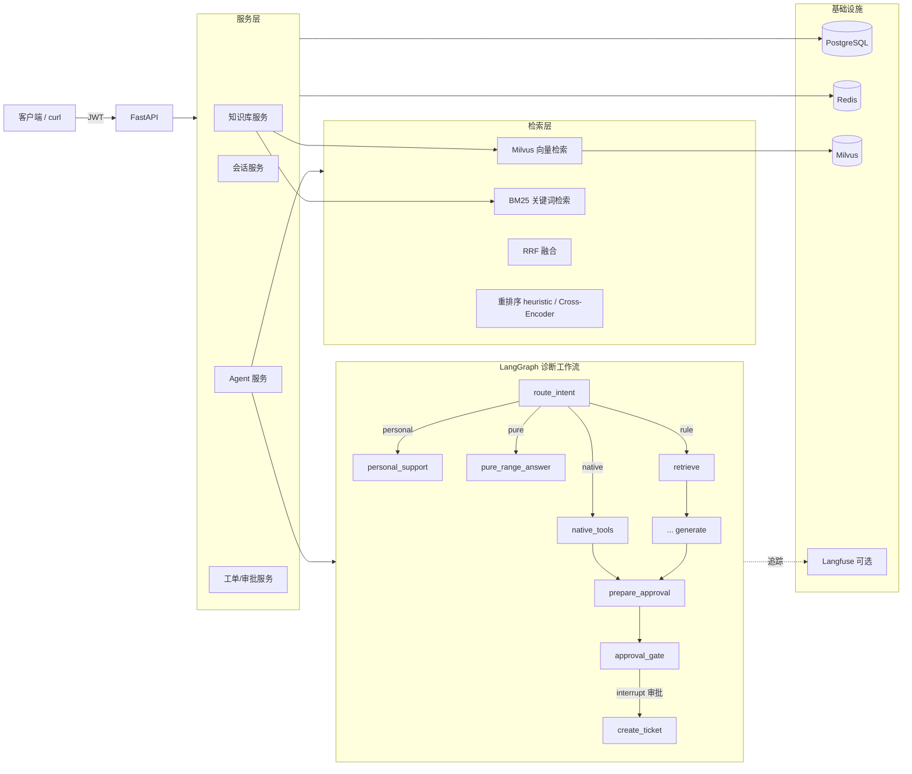
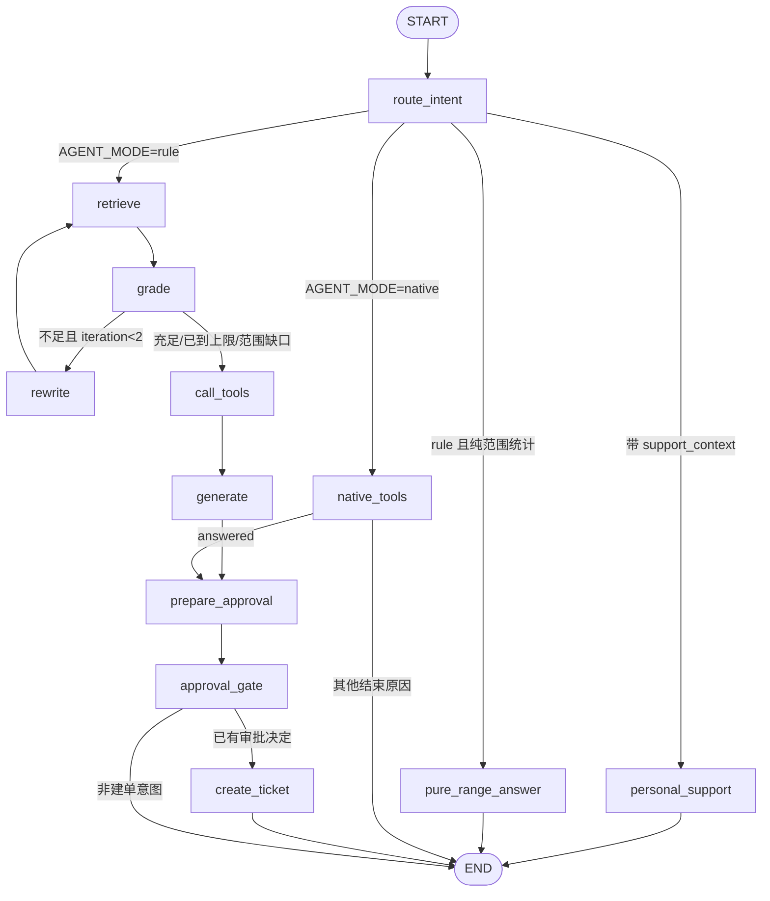

# 架构设计

## 1. 总体架构

## 2. 混合检索链路

1. **分块入库**。Markdown 文档按标题切分后逐块向量化，写入 Milvus 并更新 BM25 索引。向量记录保留 `tenant_id`、`doc_id`、`version_id` 和引用所需的分块信息。
2. **在线检索**（`HybridRetriever.retrieve`）：
   - `dense` 将查询向量化，在 Milvus 按 `tenant_id` 和有效版本过滤后检索。
   - `bm25`：jieba 分词 + ASCII 词元（保证 `ERR_5003`、`order-service` 整体命中）→ rank-bm25 打分（先词面预过滤再排序，规避小语料负 idf 问题）；
   - `hybrid`：两路各取 Top-K 后 **RRF 融合**：`score(d) = Σ 1/(k + rank_i(d))`；
   - 可选重排：`heuristic`（词面重合度，离线可用）或 `cross_encoder`（sentence-transformers，惰性加载，失败自动退化）。
3. **检索日志**：每次检索写入 `retrieval_logs`（模式/命中/得分/耗时），供效果分析。

> 部署约束：BM25 索引保存在 API 进程内存（`app/rag/bm25.py`），启动时由 `kb_service` 从向量库已有分块全量重建；入库 worker、预算账本同样是进程内状态。因此当前只支持**单 API 实例 / 单 worker**。多实例需先把关键词检索移出进程（如 Milvus 2.5+ 的 BM25 稀疏向量）。

不同检索方案的效果对比由 `python -m eval.run_eval` 自动完成（见 docs/EVAL.md）。

## 3. LangGraph 诊断工作流

图定义见 `app/agent/graph.py`，`route_intent` 之后由 `select_path` 分成四条路径：

| 路径 | 入口条件 | 说明 |
| --- | --- | --- |
| personal | state 带 `support_context`（个人排障） | `support_service.run_personal`：原生工具循环，只开放资料检索与本人案例检索 |
| native | `AGENT_MODE=native` | 真实模型通过 Function Calling 调用资料检索和历史故障工具。日志和指标工具由 `DRILL_ENABLED` 控制 |
| pure | `AGENT_MODE=rule` 且策略为 `range_stats_direct` | 纯日志行范围统计，由确定性代码直接回答 |
| rule | `AGENT_MODE=rule` | 由程序选择检索和故障史工具，演练开启后可查指标。相关性判断、改写和回答使用当前配置的模型 |

`LLM_PROVIDER=mock` 为离线规则链提供固定响应，适合验证流程。配置 `LLM_PROVIDER=openai` 后，规则链仍由程序控制工具选择，原生模式由模型选择工具。个人排障优先走表中的 personal 路径。

| 节点 | 职责 |
| --- | --- |
| route_intent | 规则识别意图与证据策略，并重置上一轮残留状态 |
| retrieve / grade / rewrite | 混合检索、LLM 判断证据是否充足、查询改写 |
| call_tools | 抽取错误码/服务名 → 调用指标查询 + 故障史工具 |
| generate | 生成带引用的回答；建单意图时生成工单草稿 |
| prepare_approval | 建单意图时幂等创建 `approval_requests` 记录 |
| approval_gate | 建单意图时 `interrupt()` 暂停图，等待人工审批 |
| create_ticket | 按审批决定创建工单（落库）或标记拒绝 |

**人工审批（human-in-the-loop）**：

- 首次到达 prepare_approval：`get_or_create` 生成 `approval_requests` 记录（幂等，防止恢复重放时重复创建）；approval_gate 随后 `interrupt(payload)` 暂停整图；
- 客户端通过 `GET /api/agent/sessions/{id}/pending-approval` 查询待审批单；
- 审批人调用 `POST /api/agent/approvals/{id}/decide`：服务端以 `Command(resume={"approved":..., "decided_by":...})` 恢复图执行 → approval_gate 重放时 `interrupt()` 直接返回审批决定 → create_ticket 落库并闭环。

**检查点**以会话 ID 为线程标识。PostgreSQL 使用持久化 `PostgresSaver`（基于 `psycopg_pool` 连接池，后台运行线程与请求线程不共用单连接），本地可通过 `CHECKPOINT_PATH` 使用 SQLite 检查点，离线测试使用内存检查点。

工作台发起调查时，将请求和进展存入 `agent_runs` 与 `agent_run_events`。当前部署在单 API 实例内用后台线程执行，浏览器的 SSE 连接负责接收事件。断线后同一运行可按事件游标补读。服务重启时，启动流程重新接收尚在运行的后台任务，并从已提交的节点恢复。中断时尚未提交检查点的节点可能重跑。内存检查点模式可重新执行任务，但重启后只能从任务起点开始。

## 4. 数据模型（PostgreSQL 与离线 SQLite）

| 表 | 说明 |
| --- | --- |
| tenants / users | 租户与用户（PBKDF2 密码哈希，role: admin/engineer/viewer） |
| chat_sessions / messages | 聊天会话与消息（消息 meta 存引用、意图、工单 ID） |
| documents | 知识库文档元数据与全文，向量存储在 Milvus |
| fault_records | 历史故障记录（Agent 故障史工具的数据源） |
| tickets / approval_requests | 工单与 LangGraph interrupt 审批单 |
| retrieval_logs | 检索日志（模式/命中/得分/耗时） |

**租户隔离**。业务查询和 Milvus 检索按 `tenant_id` 过滤，BM25 按租户分桶。

## 5. SSE 事件协议

`POST /api/agent/chat/stream` 以 `text/event-stream` 推送，用空行分隔事件。工作台发送 `background: true` 启用后台运行，先接收带运行编号的 `connected` 事件，再接收带事件编号的增量。刷新后可从会话详情的 `active_run_id` 找到后台运行，并用 `GET /api/agent/runs/{run_id}/events?after={事件编号}` 重连。未启用该字段的调用沿用请求内流式执行。

| type | 载荷 | 说明 |
| --- | --- | --- |
| start | session_id, question | 开始处理 |
| node_status | node, status | 节点完成：route_intent/retrieve/grade/rewrite/call_tools/generate/approval_gate/create_ticket |
| retrieval | mode, hits[], round, latency_ms | 检索命中（含模式与轮次，可观测补充检索） |
| grade | docs_sufficient, iteration | 相关性判断结果 |
| rewrite | rewritten | 查询改写结果 |
| tool | name, args, summary, anomalies[] | 工具调用事件（指标/故障史） |
| answer | answer, citations[] | 回答与引用 |
| approval_required | approval_id, ticket_draft | 需要人工审批（图已暂停） |
| ticket_created / ticket_rejected | ticket_id / comment | 审批闭环 |
| final | status(answered/approval_required), answer, citations, intent, ticket_id | 最终结果 |
| done | — | 结束 |

## 6. 降级策略（可验收性设计）

| 依赖 | 配置 | 失败行为 |
| --- | --- | --- |
| Milvus | `VECTOR_STORE_BACKEND=milvus`（默认） | 连接或集合不匹配时报告错误 |
| 离线向量库 | `VECTOR_STORE_BACKEND=memory` | 显式使用进程内向量检索 |
| Redis | `REDIS_URL` | 不可达自动退化为进程内缓存/计数器 |
| LLM | `LLM_PROVIDER=mock` | 规则式回答（确定性，便于测试/验收）；openai 模式调用失败回退规则式 |
| Embedding | `EMBEDDING_PROVIDER=mock` | 词面哈希向量（语义≈词面重合）；生产切换 OpenAI 兼容 API |
| Langfuse | 未配置 Key | 追踪退化为本地日志，不影响业务 |

## 7. 个人网站维护

- 用户为登记的公开网址开启定时 GET 巡检，间隔为 5、15、30 或 60 分钟。后台线程从数据库读取到期任务，连续三次异常响应或超时生成带证据的问题，同一轮异常只创建一条。收到正常响应后结束本轮巡检异常，问题结局由维护者确认。
- 个人诊断先读取日志摘要与代表行，再按证据编号和行号定向补读。报告保存调查范围、候选原因的正反证据和缺失信息。`python -m eval.support_evidence_eval` 使用固定样本比较全文与摘要方案的引用、复测判定、本地处理耗时和估算输入 Token。
- 问题所有者可把证据快照交接给同租户成员。接手者在问题中心复核快照并反馈意见，所有者可撤回或重新交接。
- 首页各区域独立加载，最新动态按当前账户全部网站的事件时间排序。

## 8. 可观测性（Langfuse）

`services/observability.py` 提供 `Tracer.span(name, **meta)`，覆盖：

- `retrieval`（模式、租户、命中数）
- `rewrite_query`、`tools`（工具清单与耗时）
- `generate`（回答长度）
- Token 用量：`estimate_tokens()` 对输入/输出做近似统计并随 span 上报（配置真实 LLM 时可接入官方 usage）。

配置 `LANGFUSE_PUBLIC_KEY/SECRET_KEY/HOST` 后自动上报 Langfuse Cloud 或自建实例；未配置时全部退化为本地日志。
