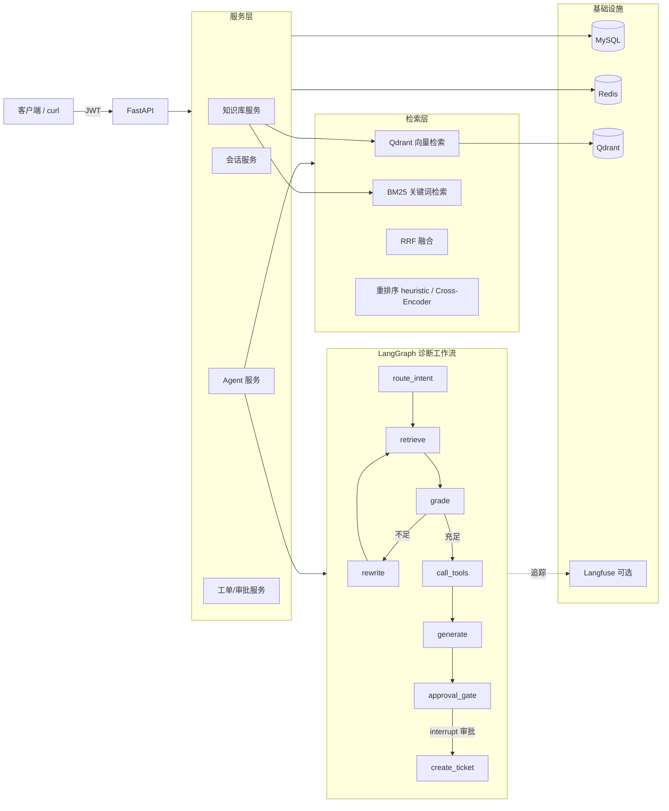

# 架构设计

## 1. 总体架构

## 2. 混合检索链路

1. **分块入库**：Markdown 文档按标题切分 + 滑动窗口（500 字，80 重叠）→ 逐块向量化 → Qdrant upsert（payload 携带 `tenant_id/doc_id/doc_title/text`）→ BM25 增量索引。
2. **在线检索**（`HybridRetriever.retrieve`）：
   - `dense`：查询向量化 → Qdrant `query_points` 带 `tenant_id` 过滤；
   - `bm25`：jieba 分词 + ASCII 词元（保证 `ERR_5003`、`order-service` 整体命中）→ rank-bm25 打分（先词面预过滤再排序，规避小语料负 idf 问题）；
   - `hybrid`：两路各取 Top-K 后 **RRF 融合**：`score(d) = Σ 1/(k + rank_i(d))`；
   - 可选重排：`heuristic`（词面重合度，离线可用）或 `cross_encoder`（sentence-transformers，惰性加载，失败自动退化）。
3. **检索日志**：每次检索写入 `retrieval_logs`（模式/命中/得分/耗时），供效果分析。

不同检索方案的效果对比由 `python -m eval.run_eval` 自动完成（见 docs/EVAL.md）。

## 3. LangGraph 诊断工作流

| 节点 | 职责 | 出边 |
| --- | --- | --- |
| route_intent | 规则识别“创建工单/诊断”意图，并重置上一轮残留状态 | retrieve |
| retrieve | 混合检索（首轮用原问题，补充轮用改写查询） | grade |
| grade | LLM 判断文档是否足以回答；iteration 自增 | 不足且 iteration<2 → rewrite；否则 call_tools |
| rewrite | 查询改写（补充同义词/术语） | retrieve（最多补充 1 轮） |
| call_tools | 抽取错误码/服务名 → 调用指标查询 + 故障史工具，产出 tool_events | generate |
| generate | 生成带引用 `[n]` 的回答；建单意图时生成工单草稿 | approval_gate |
| approval_gate | 建单意图时 `interrupt()` 暂停图，等待人工审批 | 审批后 → create_ticket；否则 END |
| create_ticket | 按审批决定创建工单（落库）或标记拒绝 | END |

**人工审批（human-in-the-loop）**：

- 首次到达 approval_gate：`get_or_create` 生成 `approval_requests` 记录（幂等，防止恢复重放时重复创建）→ `interrupt(payload)` 暂停整图；
- 客户端通过 `GET /api/agent/sessions/{id}/pending-approval` 查询待审批单；
- 审批人调用 `POST /api/agent/approvals/{id}/decide`：服务端以 `Command(resume={"approved":..., "decided_by":...})` 恢复图执行 → approval_gate 重放时 `interrupt()` 直接返回审批决定 → create_ticket 落库并闭环。

**Checkpointer**：`MemorySaver`（thread_id = 会话 ID）。生产多 worker 部署时建议替换为持久化 checkpointer（`langgraph-checkpoint-postgres` 等）。

## 4. 数据模型（MySQL / SQLite 兼容）

| 表 | 说明 |
| --- | --- |
| tenants / users | 租户与用户（PBKDF2 密码哈希，role: admin/engineer/viewer） |
| chat_sessions / messages | 聊天会话与消息（消息 meta 存引用、意图、工单 ID） |
| documents | 知识库文档元数据与全文（向量在 Qdrant） |
| fault_records | 历史故障记录（Agent 故障史工具的数据源） |
| tickets / approval_requests | 工单与 LangGraph interrupt 审批单 |
| retrieval_logs | 检索日志（模式/命中/得分/耗时） |

**租户隔离**：业务查询全部强制 `tenant_id` 过滤；Qdrant 检索带 `Filter(key=tenant_id)`；BM25 按租户分桶。

## 5. SSE 事件协议

`POST /api/agent/chat/stream` 以 `text/event-stream` 推送，每行 `data: {json}`：

| type | 载荷 | 说明 |
| --- | --- | --- |
| start | session_id, question | 开始处理 |
| node_status | node, status | 节点完成：route_intent/retrieve/grade/rewrite/call_tools/generate/approval_gate/create_ticket |
| retrieval | mode, hits[], round, latency_ms | 检索命中（含模式与轮次，可观测补充检索） |
| grade | docs_sufficient, iteration | 相关性判断结果 |
| rewrite | rewritten | 查询改写结果 |
| tool | name, args, summary, anomalies[] | 工具调用事件（指标/故障史） |
| answer | answer, citations[] | 回答与引用 |
| approval_required | approval_id, ticket_draft | 需要人工审批（图已暂停） |
| ticket_created / ticket_rejected | ticket_id / comment | 审批闭环 |
| final | status(answered/approval_required), answer, citations, intent, ticket_id | 最终结果 |
| done | — | 结束 |

## 6. 降级策略（可验收性设计）

| 依赖 | 配置 | 失败行为 |
| --- | --- | --- |
| Qdrant | `QDRANT_MODE=memory`（默认） | 进程内向量库 + 启动时从 MySQL 回填 |
| Qdrant | `remote` | 连接失败自动退化为进程内并告警日志 |
| Redis | `REDIS_URL` | 不可达自动退化为进程内缓存/计数器 |
| LLM | `LLM_PROVIDER=mock` | 规则式回答（确定性，便于测试/验收）；openai 模式调用失败回退规则式 |
| Embedding | `EMBEDDING_PROVIDER=mock` | 词面哈希向量（语义≈词面重合）；生产切换 OpenAI 兼容 API |
| Langfuse | 未配置 Key | 追踪退化为本地日志，不影响业务 |

## 7. 可观测性（Langfuse）

`services/observability.py` 提供 `Tracer.span(name, **meta)`，覆盖：

- `retrieval`（模式、租户、命中数）
- `rewrite_query`、`tools`（工具清单与耗时）
- `generate`（回答长度）
- Token 用量：`estimate_tokens()` 对输入/输出做近似统计并随 span 上报（配置真实 LLM 时可接入官方 usage）。

配置 `LANGFUSE_PUBLIC_KEY/SECRET_KEY/HOST` 后自动上报 Langfuse Cloud 或自建实例；未配置时全部退化为本地日志。
